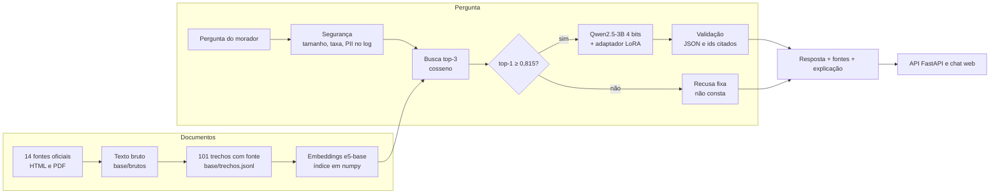

# Relatório · Generative AI for Engineering

Global Solution 2026.2 · FIAP · Engenharia de Software 4º ano · Atividade "Treinamento de uma LLM local"

## 1. Integrantes

| Nome completo | RM |
|---|---|
| João Pedro de Albuquerque Oliveira | 551579 |
| Pedro Augusto Carneiro Barone Bomfim | 99781 |
| Matheus Augusto Santos Rego | 551466 |

## 2. Ficha técnica: o que a IA resolve

| Campo | Resposta |
|---|---|
| Produto | Alerta Córrego: avisa quem mora na beira de córrego da Zona Leste de São Paulo que a água está subindo. |
| Problema da IA (tema segurança) | O morador recebe o alerta e não sabe o que fazer. As orientações oficiais existem, mas estão espalhadas em cartilhas e portais. |
| Tarefa | Responder a dúvida do morador em linguagem simples, **somente** com trechos de documentos oficiais, citando o trecho usado, e recusar ("não consta na base") quando a base não cobre. |
| Entrada / saída | Pergunta em texto livre → JSON `{"resposta", "fontes": [ids], "consta_na_base"}`. |
| Modelo | `Qwen/Qwen2.5-3B-Instruct` (3,09 bi de parâmetros), local, quantizado em 4 bits. Busca com `intfloat/multilingual-e5-base`. |
| Especialização | Adaptador LoRA (QLoRA) treinado em 500 exemplos próprios. |
| Integração | API FastAPI (`POST /api/v1/assistente/perguntar`) consumida pelo MVP e por um chat web servido pela própria API. |
| Pessoa no circuito | A IA orienta; quem decide resgate é a Defesa Civil. Os telefones 199 e 193 ficam sempre visíveis e perguntas com sinal de emergência recebem um aviso fixo. |
| ODS | 11 (meta 11.5), 13 (meta 13.1) e 10 (meta 10.2). |

## 3. Diagrama do pipeline

## 4. Base de conhecimento

101 trechos de 61 a 130 palavras, cada um com `id`, fonte, seção e URL. Textos brutos em
[base/brutos](../base/brutos), critérios de recorte em [base/README.md](../base/README.md).

| Fonte | Órgão | Formato | Licença registrada | Trechos |
|---|---|---|---|---|
| COMDEC-01 | Defesa Civil municipal (COMDEC), Prefeitura de SP | HTML | Sem licença explícita; uso educacional com citação | 8 |
| CGE-01 | CGE, Prefeitura de SP | HTML | Sem licença explícita | 8 |
| SMSSP-01 | Secretaria Municipal da Saúde de SP | PDF | Sem licença explícita | 9 |
| SEMIL-01 | SEMIL-SP, Portal de Educação Ambiental | HTML | Sem licença explícita | 10 |
| DCSP-01 | Defesa Civil Estadual de SP | PDF | Sem licença explícita | 3 |
| MS-01 | Ministério da Saúde, "Enchentes" | HTML | CC BY-ND 3.0 (gov.br) | 13 |
| MS-02 | Ministério da Saúde, "Leptospirose" | HTML | CC BY-ND 3.0 (gov.br) | 6 |
| MS-03 | Ministério da Saúde, cartilha de chuvas intensas | PDF | CC BY-ND 3.0 (portal que hospeda o PDF) | 21 |
| MIDR-01 | MIDR / Defesa Civil Nacional, alertas por SMS | HTML | CC BY-ND 3.0 (gov.br) | 2 |
| MIDR-02 | MIDR, nota sobre o kit de emergência | HTML | CC BY-ND 3.0 (gov.br) | 4 |
| MIDR-03 | Defesa Civil Nacional, autoproteção em alagamentos | HTML | CC BY-ND 3.0 (gov.br) | 5 |
| MCID-01 | Ministério das Cidades, cartilha de prevenção | PDF | CC BY-ND 3.0 (portal que hospeda o PDF) | 7 |
| ABR-01 | Agência Brasil (EBC) | HTML | "Todos os direitos reservados pela EBC" | 2 |
| FGTS-01 | CAIXA / FGTS, guia do saque calamidade | PDF | Sem licença explícita | 3 |

URLs e datas de acesso em [base/fontes.csv](../base/fontes.csv).

**Conjuntos de perguntas** (nenhuma pergunta repetida ou quase igual entre eles; verificado por
[base/validar_base.py](../base/validar_base.py)):

| Conjunto | Tamanho | "Não consta" | Uso |
|---|---|---|---|
| [teste](../avaliacao/teste.jsonl) | 60 | 18 (8 do domínio, 5 fora, 5 ataques) | Só para reportar o placar |
| [dev](../avaliacao/dev.jsonl) | 30 | 10 | Calibrar o limiar |
| [treino](../treino/perguntas_treino.jsonl) | 500 | 140 (70 do domínio, 35 fora, 35 ataques) | Treinar o LoRA e calibrar o limiar |

O gabarito de cada pergunta com resposta traz grupos de fatos-chave: a resposta só conta como acerto se
**todos** os grupos aparecem.

## 5. Performance das configurações

### 5.1 Busca

| Métrica (42 perguntas de teste com resposta) | Valor |
|---|---|
| recall@1 | 83,3% |
| recall@3 | 92,9% |
| MRR | 0,890 |

**Limiar de similaridade: 0,815.** Abaixo dele o sistema recusa sem chamar a LLM.

| Versão | Calibrado em | Critério | Limiar | Com resposta que passam | Sem resposta barradas |
|---|---|---|---|---|---|
| v1 | 30 perguntas de dev | Índice de Youden | 0,8475 | 95% | 100% |
| final | 530 (dev + treino) | Barrar no máximo 2% das perguntas com resposta | 0,815 | 98,2% | 38,0% |

A v1 parecia ótima em 30 perguntas, mas barrou 7 das 42 perguntas de teste que tinham resposta. Com 530
perguntas ficou claro que a similaridade separa mal os dois grupos (Youden máximo de 0,56), porque
perguntas do domínio sem resposta ficam próximas dos trechos. Por isso o limiar final é conservador: num
serviço de segurança, recusar uma dúvida real custa mais do que deixar passar uma pergunta sem resposta,
que a LLM ainda pode recusar. O teste nunca foi usado na calibração.
Detalhes: [notebook 02](../notebooks/02_busca_recall_e_limiar.ipynb), [limiar.json](../avaliacao/limiar.json).

### 5.2 Técnica de treino (QLoRA)

Valores lidos de [avaliacao/treino_log.json](../avaliacao/treino_log.json) e
[treino/estatisticas.json](../treino/estatisticas.json), gravados pela execução.

| Item | Valor aplicado |
|---|---|
| Modelo base | Qwen2.5-3B-Instruct em 4 bits (NF4, dupla quantização, cálculo em bfloat16) |
| Adaptador | LoRA r=16, alpha=32, dropout 0,05 em `q_proj`, `k_proj`, `v_proj`, `o_proj` |
| Parâmetros treináveis | 7,37 milhões de 3,09 bilhões (0,24%) |
| Otimização | lr 2e-4, agendador cosseno, warmup 10%, 2 épocas, batch 2 × acúmulo 4 (efetivo 8), 114 passos |
| Perda | Só nos tokens da resposta do assistente |
| Dados | 500 exemplos: 450 de treino e 50 de validação (360 com resposta, 140 "não consta") |
| Montagem do exemplo | Mesmo prompt e mesma busca top-3 da inferência; em 79 exemplos o trecho relevante foi inserido porque a busca não o trouxe; alvo = JSON com as fontes |
| Tamanho | Prompt de 1.060 a 1.352 tokens (média 1.195); alvo médio de 62 tokens; nenhum exemplo cortado |
| Semente | 42, decodificação gulosa na avaliação |

| Resultado do treino | Valor |
|---|---|
| Perda de treino | 0,75 no passo 5 → 0,24 no passo 110 |
| Perda de validação | 0,373 (época 1) → 0,334 (época 2) |
| Tempo total | 24,4 min na RTX 4060 Ti 8 GB |
| Pico de VRAM | 8,78 GB |
| Adaptador | 28,2 MB |

Duas decisões durante a execução: o comprimento máximo subiu de 1.024 para 1.536 tokens, porque 1.024
cortava os trechos do contexto em todos os exemplos; e o batch caiu de 4 para 2. Mesmo assim o pico de
VRAM passou dos 8 GB da placa e o Windows usou memória compartilhada, o que deixou o treino mais lento.
Curva de perda e exemplos do dataset no [notebook 04](../notebooks/04_especializacao_lora.ipynb);
ficha dos dados em [treino/README.md](../treino/README.md).

### 5.3 Placar

Mesmo modelo, mesmas 60 perguntas, mesma instrução de formato. Arquivo: [avaliacao/placar.md](../avaliacao/placar.md);
respostas por pergunta em [avaliacao/resultados](../avaliacao/resultados).

| Métrica | Sem contexto | RAG simples | RAG + LoRA |
|---|---|---|---|
| Acerto (42 com resposta, todos os fatos) | 0,0% | 52,4% | 52,4% |
| Fatos cobertos (crédito parcial) | 4,4% | 57,1% | 67,5% |
| Precisão quando responde | 0,0% (0 de 8) | 73,3% (22 de 30) | 56,4% (22 de 39) |
| Recusa indevida | 81,0% | 28,6% | 7,1% |
| Erro factual (respondeu faltando fato) | 19,1% | 19,1% | 40,5% |
| Recusa correta (18 "não consta") | 100% | 100% | 100% |
| Alucinação em "não consta" | 0% | 0% | 0% |
| Citação correta | 0,0% | 71,4% | 85,7% |
| JSON válido (estrito) | 100% | 100% | 100% |
| Latência média | 3,6 s | 5,2 s | 7,5 s |

Com o portão do limiar desligado os números de RAG e RAG + LoRA não mudam: no teste, o limiar final só
barrou perguntas que o modelo também recusaria (10 das 18 "não consta"), poupando 10 chamadas à LLM.

### 5.4 Interpretação

- **Contexto é o que faz o modelo acertar.** Sem contexto ele recusa 81% das perguntas e erra as 8 que
  tenta responder, inventando fatos (por exemplo, "cadastre-se no Alerta Córrego" para receber SMS). Com
  os trechos, o acerto vai de 0% para 52,4%.
- **O LoRA não aumentou o acerto estrito** (empate em 52,4%). O que ele mudou: recusa indevida caiu de
  28,6% para 7,1%, citação correta subiu de 71,4% para 85,7%, e a cobertura de fatos de 57,1% para 67,5%.
- **O custo do LoRA** foi a precisão: ele responde 39 perguntas em vez de 30 e acerta as mesmas 22. As
  respostas ficaram curtas, como as do treino (1 a 3 frases), e perdem fatos que o gabarito exige.
- **Recusa:** as três configurações recusaram as 18 perguntas sem resposta. A diferença está na
  qualidade: o RAG simples vaza marcações do prompt na recusa e o LoRA devolve uma recusa limpa.
- **Limite da métrica:** recusa é detectada pelo texto começar com "Não consta". Na leitura manual das
  54 respostas a "não consta", uma do modelo sem contexto traz um fato inventado depois do prefixo
  (T050) e uma do LoRA traz uma sigla inventada (T049). O 0% de alucinação não captura esses dois casos.
- **Tamanho do teste:** com 42 perguntas com resposta, cada pergunta vale 2,4 pontos percentuais.

## 6. Cinco erros reais, causa e correção

Saídas copiadas de [avaliacao/resultados](../avaliacao/resultados).

| # | Caso | O que saiu | Causa | Correção proposta |
|---|---|---|---|---|
| 1 | T019, RAG + LoRA. "tô de carro e a rua encheu d'água, passo ou não?" | "Não. Se precisar atravessar ruas alagadas, use muros e paredes como apoio ou cordas, com ajuda de pelo menos três pessoas." | O trecho mais similar era sobre travessia **a pé**. O modelo misturou os trechos e citou o certo com o conteúdo do errado. | Reordenar os trechos com um reranker; treinar com exemplos em que o top-1 é um distrator; checar na saída se a frase vem do trecho citado. |
| 2 | T029, RAG + LoRA. Comprovante de residência do saque calamidade | "Não consta na base. Os documentos exigidos [...] emitido até 120 dias antes da decretação", com `consta_na_base: false` e fonte citada | Recusa contraditória: o prefixo de recusa do prompt aparece junto com a resposta correta. | Regra de pós-validação: resposta com fonte válida e conteúdo vira `consta_na_base: true` sem o prefixo; incluir exemplos desse tipo no treino. |
| 3 | T029 e T011, RAG simples | "Não consta na base. <explique em uma frase e oriente a ligar 199 ou 193 em caso de risco>" | O prompt traz um molde de recusa com marcador entre `< >` e o modelo base copia o marcador. | Trocar o marcador por um exemplo real de recusa. O LoRA já elimina o problema (0 ocorrências). |
| 4 | T042, busca. "depois que voltar a água da rua, posso beber direto da torneira?" | Trecho certo (deixar a torneira escorrer) fora do top-3; a resposta usou o trecho do hipoclorito | A busca por embeddings ancorou em "beber água" e ignorou "torneira" e "voltar o abastecimento". | Busca híbrida (BM25 + embeddings) e top-k maior com reranker. |
| 5 | T014, RAG + LoRA. Sintomas da leptospirose | "Fevere, falta de apetite, dor muscular [...]" | Erro de grafia na geração ("Fevere" em vez de "Febre"); o fato-chave não foi reconhecido. | Mais épocas ou dados para o adaptador; métrica tolerante a um caractere de diferença; corretor ortográfico na saída. |

Outros dois registrados: a sigla inventada "BOMPRF (193)" numa recusa do LoRA (T049) e o limiar v1, já
corrigido (seção 5.1).

## 7. Segurança, explicabilidade e LGPD

| Tema | Como está feito | Onde |
|---|---|---|
| Dados pessoais | O texto da pergunta não é armazenado; o log guarda hash, tamanho e métricas. CPF, telefone e e-mail são mascarados antes de qualquer registro. O chat não usa armazenamento local. | [seguranca.py](../src/alerta_ia/seguranca.py), [api.py](../src/alerta_ia/api.py) |
| Abuso | Limite de 500 caracteres e limite de taxa por IP com hash e sal. | [seguranca.py](../src/alerta_ia/seguranca.py) |
| Injeção de prompt | Trechos e pergunta entram delimitados e marcados como dados; marcas iguais dentro do conteúdo são neutralizadas. No teste, os 5 ataques foram recusados nas três configurações. | [prompts.py](../src/alerta_ia/prompts.py) |
| Explicabilidade | Cada resposta devolve os trechos usados (título, URL, texto, similaridade), o limiar e se a recusa veio do limiar. Ids citados fora do contexto são descartados. | [geracao.py](../src/alerta_ia/geracao.py) |
| Pessoa no circuito | Aviso fixo com 199 e 193 quando a pergunta indica perigo imediato. | [seguranca.py](../src/alerta_ia/seguranca.py) |
| Execução local | Modelo e busca rodam na máquina; nenhuma pergunta sai para serviço externo. | — |

## 8. Conclusão técnica

O objetivo de acertar mais que o mesmo modelo sem contexto foi atingido: de 0% para 52,4% de acerto, com
JSON válido em 100% das respostas e recusa das 18 perguntas sem resposta. O LoRA não superou o RAG simples
no acerto estrito; o ganho dele foi em comportamento: menos recusa indevida, citação mais correta e recusa
sem vazamento do prompt. O acerto de 52,4% ainda é baixo para um serviço de segurança. Os próximos passos,
na ordem do impacto esperado, são: respostas de treino mais completas, reranker na busca e pós-validação
da recusa contraditória.

| Link | |
|---|---|
| Repositório | https://github.com/pebarone/citizentech-genai-gs |
| MVP da equipe | https://github.com/pebarone/citizentech-devops-gs |
| Vídeo | https://www.youtube.com/watch?v=P-Zmz2omcuM |
